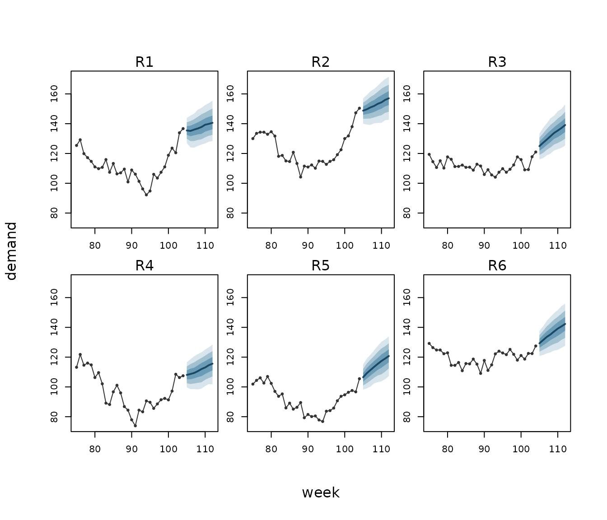

# Forecasting series

This vignette forecasts several series at once: the rows a forecast
needs, a model whose forecasts carry each series on from where its data
end, a covariate whose future is not known, fan charts, and totals
across series and over the horizon. Along the way, a check on the
model’s trend finds something to change, and the change is made.

``` r

library(limn)
#> Loading required package: illume
#> Loading required package: illumex
```

## The data

Six regions report their weekly demand for two years. Demand rises with
the temperature, grows slowly over time, and each region has runs of
high and low weeks. The temperature follows the seasons, with runs of
warm and cool weeks of its own.

``` r

set.seed(2026)
n_regions <- 6; n_weeks <- 104
demand <- expand.grid(week = 1:n_weeks, region = factor(sprintf("R%d", 1:n_regions)))
runs <- function(phi, sd) unlist(lapply(1:n_regions, function(r)
  as.numeric(stats::arima.sim(list(ar = phi), n_weeks, sd = sd))))
demand$temp <- round(15 + 8 * sin(2 * pi * demand$week / 52) + runs(0.7, 1.5), 1)
region_effect <- rnorm(n_regions, 0, 10)
demand$demand <- round(100 + 0.15 * demand$week + 2 * (demand$temp - 15) +
                         region_effect[demand$region] + runs(0.8, 2) +
                         rnorm(nrow(demand), 0, 2), 1)
```

## The rows a forecast needs

[`ilm_future()`](https://huttoncp.github.io/limn/reference/ilm_future.md)
builds the next weeks of every region. It copies what does not change
over time and leaves what does, the temperature, for you to fill in:

``` r

future <- ilm_future(demand, time = "week", group = "region", h = 8, response = "demand")
#> These columns vary over time, so their future values are not known: temp. They are left missing: fill them in with the values the forecast should assume.
head(future, 3)
#>   week region temp demand horizon
#> 1  105     R1   NA     NA       1
#> 2  106     R1   NA     NA       2
#> 3  107     R1   NA     NA       3
```

For a start, fill in a scenario: the temperature’s seasonal average,
with no warm or cool runs.

``` r

scenario <- future
scenario$temp <- round(15 + 8 * sin(2 * pi * scenario$week / 52), 1)
```

## A first model, and the trend check

A first model has the temperature, a linear trend in time, a level for
each region, and a first-order autoregressive term,
[`ilm_ar1()`](https://rdrr.io/pkg/illume/man/ilm_ar1.html), for each
region’s runs of weeks. Forecasting with it warns:

``` r

fit_ar1 <- illume::ilm_model(demand ~ temp + week + (1 | region), data = demand,
                             family = "gaussian", ar = illume::ilm_ar1(~ week | region),
                             verbose = FALSE)
fc_ar1 <- ilm_forecast(fit_ar1, scenario, nsim = 500)
#> Warning: The model trends in `week` (week). Forecasts past the data assume that
#> the trend's slope does not change (the reference), so their intervals leave out
#> any change in it (limn's own reasoning). Reference: Hyndman and Athanasopoulos
#> (2021), Forecasting: Principles and Practice, 3rd edition, section 10.4. For
#> longer horizons a stochastic trend is safer (the reference): a random walk, ar
#> = ilm_rw1(~ week | region), lets the level move, and the intervals widen with
#> the horizon (in place of the model's ar1 term: a model has one correlation over
#> time).
```

A trend in the fixed part assumes the growth goes on at the same rate,
and, in limn’s own reasoning, its intervals then leave out any change in
that rate. The warning names the remedy, citing Hyndman and
Athanasopoulos (2021, section 10.4) for a stochastic trend being safer
at longer horizons: a random walk,
[`ilm_rw1()`](https://rdrr.io/pkg/illume/man/ilm_rw1.html), which lets
each region’s level move. Refit with it in place of the autoregressive
term, and forecast again:

``` r

fit <- illume::ilm_model(demand ~ temp + week + (1 | region), data = demand,
                         family = "gaussian", ar = illume::ilm_rw1(~ week | region),
                         verbose = FALSE)
fc_scenario <- ilm_forecast(fit, scenario, nsim = 500)
```

No warning now. The width of region R1’s 90% interval at each horizon
shows the difference:

``` r

width_r1 <- function(fc) {
  a <- as.data.frame(fc)
  a <- a[a$region == "R1", ]
  setNames(round(a$upper_0.9 - a$lower_0.9, 1), paste0("h", a$horizon))
}
rbind(ar1 = width_r1(fc_ar1), rw1 = width_r1(fc_scenario))
#>       h1   h2   h3   h4   h5   h6   h7   h8
#> ar1 10.0 11.4 11.7 12.5 12.5 12.6 12.4 12.5
#> rw1 10.4 11.8 12.8 13.9 14.9 15.6 16.5 17.5
```

For region R1, under the autoregressive term the intervals stop widening
after a few weeks; under the random walk they go on widening with the
horizon. The rest of this vignette uses the random-walk model.

## A covariate whose future is not known

The scenario fixed next weeks’ temperatures, so its intervals leave out
the uncertainty in them. Hyndman and Athanasopoulos (2021, section 10.3)
note that prediction intervals made that way “do not take into account
the uncertainty in the forecasts of the predictors”.
[`ilm_covariate_paths()`](https://huttoncp.github.io/limn/reference/ilm_covariate_paths.md)
draws the temperature’s future from a model of the temperature, one path
per draw, and the forecast mixes over the paths:

``` r

fit_temp <- illume::ilm_model(temp ~ illume::ilm_fourier(week, period = 52), data = demand,
                              family = "gaussian", ar = illume::ilm_ar1(~ week | region),
                              verbose = FALSE)
paths <- ilm_covariate_paths(fit_temp, future, nsim = 500)
fc <- ilm_forecast(fit, paths, nsim = 500)
rbind(scenario = width_r1(fc_scenario), paths = width_r1(fc))
#>            h1   h2   h3   h4   h5   h6   h7   h8
#> scenario 10.4 11.8 12.8 13.9 14.9 15.6 16.5 17.5
#> paths    14.2 17.5 19.0 20.3 21.0 21.4 21.7 22.7
```

The temperature model has the seasons, as a Fourier term, and each
region’s runs of warm and cool weeks. With the temperature drawn, region
R1’s intervals are wider at every horizon. In limn’s own study of
covariates given as draws (`studies/findings/covariate_draws.md` in
limn’s GitHub repository,
<https://github.com/huttoncp/limn/blob/main/studies/findings/covariate_draws.md>),
90% intervals for a gaussian outcome made with the covariate’s point
forecast covered only 0.75 to 0.83, against about 0.90 with the
covariate given as draws.

### Paths from another tool

Paths made elsewhere, such as a weather service’s ensemble, come in
through
[`ilm_as_draws()`](https://huttoncp.github.io/limn/reference/ilm_as_draws.md).
Here a made-up ensemble of 20 paths stands in for one: a data frame with
a row per path, region and week.

``` r

ensemble <- do.call(rbind, lapply(1:20, function(k) {
  e <- future[c("region", "week")]
  e$temp <- round(15 + 8 * sin(2 * pi * e$week / 52) + rnorm(nrow(e), 0, 2), 1)
  e$.rep <- k
  e
}))
from_ensemble <- ilm_as_draws(ensemble, future, by = c("region", "week"))
head(as.data.frame(ilm_forecast(fit, from_ensemble, nsim = 500)), 3)
#>   week region temp demand horizon new_level estimate     mean lower_0.9
#> 1  105     R1   NA     NA       1     FALSE 126.4614 126.5183  117.4291
#> 2  106     R1   NA     NA       2     FALSE 129.1513 128.4540  118.0526
#> 3  107     R1   NA     NA       3     FALSE 131.9113 131.7833  122.3101
#>   upper_0.9
#> 1  135.7713
#> 2  137.2667
#> 3  141.0980
```

## The fan chart

``` r

ilm_plot_fan(fc, time = "week", group = "region",
             history = demand[demand$week > 74, ], response = "demand")
```



Each panel is one region: its last 30 weeks of demand, then the
forecast’s median as a line, with its central 50%, 80% and 95% intervals
as bands. Each region starts from its own last weeks, and the bands
widen with the horizon.

## Totals

The total over regions is not the sum of the regions’ intervals.
[`ilm_aggregate()`](https://huttoncp.github.io/limn/reference/ilm_aggregate.md)
adds the forecasts draw by draw, so what the regions share within a
draw, the parameters of the demand model and of the temperature model,
carries into the total. The total demand each week:

``` r

as.data.frame(ilm_aggregate(fc, by = "week"))
#>   week n_rows estimate     mean lower_0.9 upper_0.9
#> 1  105      6 752.7767 752.8986  735.5029  770.4155
#> 2  106      6 761.4285 760.9168  739.5225  780.1459
#> 3  107      6 770.1843 770.2665  747.9340  792.7353
#> 4  108      6 779.2362 779.5880  754.9276  804.6146
#> 5  109      6 788.9138 789.1754  762.8718  815.5906
#> 6  110      6 797.8804 798.1998  770.3953  825.9959
#> 7  111      6 807.4376 807.1211  777.5517  834.7061
#> 8  112      6 815.9679 815.7236  785.8711  845.1298
```

And each region’s total over the eight weeks, where a region’s own path
carries into its total:

``` r

as.data.frame(ilm_aggregate(fc, by = "region"))
#>   region n_rows  estimate      mean lower_0.9 upper_0.9
#> 1     R1      8 1100.5383 1101.4429 1043.3173 1162.3366
#> 2     R2      8 1221.5007 1222.0706 1157.4849 1283.8569
#> 3     R3      8 1059.1276 1058.0628 1000.2730 1114.7952
#> 4     R4      8  892.8681  891.2049  831.6517  946.3042
#> 5     R5      8  913.2609  912.9567  855.7816  968.1929
#> 6     R6      8 1089.0415 1088.1520 1025.8223 1147.7706
```

Both sets of totals come from the same draws, so the regions’ expected
totals sum to exactly the same grand total as the weeks’ do:

``` r

c(by_week = sum(as.data.frame(ilm_aggregate(fc, by = "week"))$mean),
  by_region = sum(as.data.frame(ilm_aggregate(fc, by = "region"))$mean))
#>   by_week by_region 
#>   6273.89   6273.89
```

## Where next

- [`?ilm_forecast`](https://huttoncp.github.io/limn/reference/ilm_forecast.md)
  and
  [`?ilm_predict`](https://huttoncp.github.io/limn/reference/ilm_predict.md)
  (its section *Over time*) for how a series is carried forward.
- [`?ilm_covariate_paths`](https://huttoncp.github.io/limn/reference/ilm_covariate_paths.md)
  and
  [`?ilm_as_draws`](https://huttoncp.github.io/limn/reference/ilm_as_draws.md)
  for covariates given as draws.
- [`?ilm_aggregate`](https://huttoncp.github.io/limn/reference/ilm_aggregate.md)
  for totals and averages.
- [`vignette("limn")`](https://huttoncp.github.io/limn/articles/limn.md)
  for scoring and comparing forecasts.

## References

Hyndman, R. J. and Athanasopoulos, G. (2021). *Forecasting: Principles
and Practice*, 3rd edition. OTexts. Section 10.3, “Forecasting”, and
section 10.4, “Stochastic and deterministic trends” (online edition,
<https://otexts.com/fpp3/>, read 21 October 2026).
