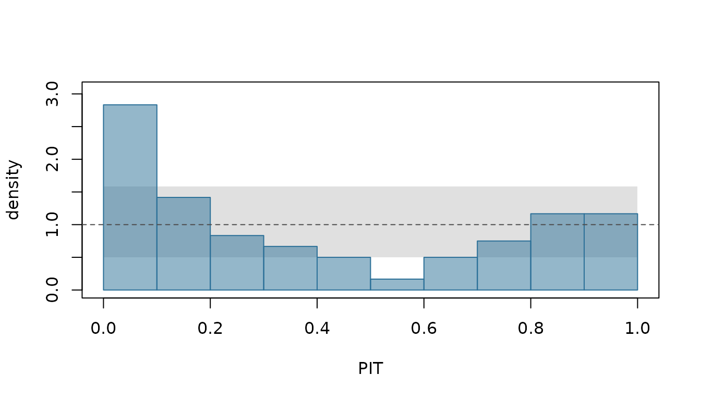
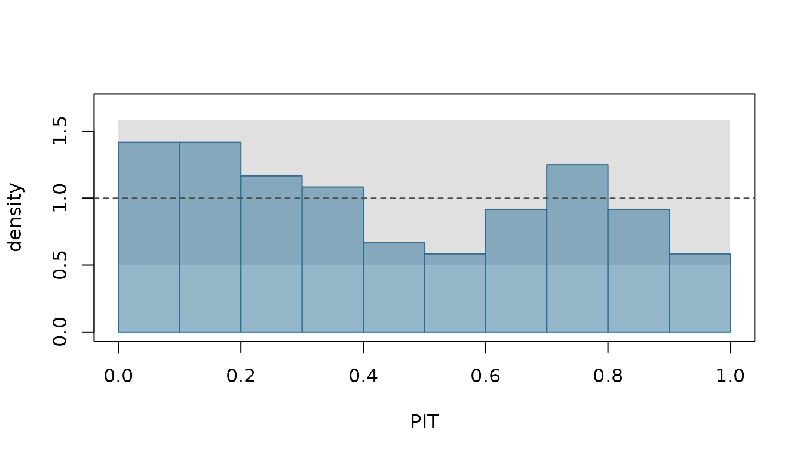

# Getting started with limn

limn turns a model fitted by
[illume](https://github.com/huttoncp/illume) into predictive
distributions: for a unit in the data or a new one, for the next weeks
of a series, or for totals over many of them. It scores those
distributions against what happened, checks their calibration, and
compares models with standard errors that respect how the data hang
together. When one of its checks finds something wrong, it says what it
found, why that matters, and what to do about it.

This vignette walks through one small example from start to finish: fit,
predict, forecast, total, score, check, remedy and compare.

``` r

library(limn)
#> Loading required package: illume
#> Loading required package: illumex
#> Registered S3 methods overwritten by 'illume':
#>   method             from   
#>   c.ilm_remedies     illumex
#>   print.ilm_remedies illumex
#> 
#> Attaching package: 'illume'
#> The following objects are masked from 'package:illumex':
#> 
#>     ilm_apply_remedy, ilm_remedies, ilm_remedy_table, iml_apply_remedy,
#>     iml_remedies, iml_remedy_table
```

## The data and a first model

Twenty clinics report their weekly number of visits for 36 weeks. A
clinic’s count depends on its size and on the temperature, and clinics
differ: some are busier than their size says. The simulation draws the
counts from a negative binomial distribution, so they vary more than
Poisson counts with the same mean would.

``` r

set.seed(1001)
n_clinics <- 20; n_weeks <- 36
clinics <- data.frame(clinic = factor(sprintf("C%02d", 1:n_clinics)),
                      size = round(runif(n_clinics, 0.5, 2), 1))
visits <- expand.grid(week = 1:n_weeks, clinic = clinics$clinic)
visits$size <- clinics$size[visits$clinic]
visits$temp <- round(10 + 8 * sin(2 * pi * visits$week / 52) + rnorm(nrow(visits)), 1)
clinic_effect <- rnorm(n_clinics, 0, 0.3)
mu <- exp(1.6 + 0.5 * log(visits$size) - 0.03 * visits$temp + clinic_effect[visits$clinic])
visits$count <- rnbinom(nrow(visits), size = 3, mu = mu)
train <- visits[visits$week <= 30, ]
test <- visits[visits$week > 30, ]
```

The last six weeks are held back to check the forecasts. The first
model, fitted by illume, is a Poisson regression with a random intercept
for each clinic. It is a reasonable first guess, and a wrong one: the
checks below find out.

``` r

fit <- illume::ilm_model(count ~ log(size) + temp + (1 | clinic), data = train,
                         family = "poisson", verbose = FALSE)
```

## Predictions: which unit?

A mixed model predicts different things for the same row, depending on
the question: this clinic, a new clinic, a typical one, or the average
over clinics. So
[`ilm_predict()`](https://huttoncp.github.io/limn/reference/ilm_predict.md)
asks. Here `groups = "fitted"` predicts each row’s own clinic. A clinic
the fit has not seen is predicted as a new one, with its effect drawn
from the fitted distribution of clinics, and is marked as such:

``` r

nd <- data.frame(clinic = c("C01", "new"), size = 1, temp = 10, week = 31)
p <- ilm_predict(fit, nd, groups = "fitted", nsim = 500)
as.data.frame(p)
#>   clinic size temp week new_level estimate     mean lower_0.9 upper_0.9
#> 1    C01    1   10   31     FALSE 4.887985 4.904412  3.928569  6.048262
#> 2    new    1   10   31      TRUE 3.856331 3.998152  2.357997  6.325314
```

These are predictions of the mean count. For clinic C01, `estimate` is
the mean at the fitted parameters; for the new clinic, whose effect is
unknown, it is the predictive median. `mean` averages over everything
the prediction is uncertain about, and the limits are those of the
central 90% interval. The new clinic’s interval is wider: it carries the
uncertainty in its own effect.

The other choices are `groups = "new"`, `"typical"` (the effects at
zero) and `"population"` (the average over clinics). By default every
parameter is drawn jointly, the variances included
(`uncertainty = "joint"`); see
[`?ilm_predict`](https://huttoncp.github.io/limn/reference/ilm_predict.md)
for the other choices.

## Forecasts

[`ilm_future()`](https://huttoncp.github.io/limn/reference/ilm_future.md)
builds the rows a forecast needs: the next weeks of every clinic. It
copies what does not change over time, such as a clinic’s size, and
leaves what does, the temperature, for you to fill in:

``` r

fut <- ilm_future(train, time = "week", group = "clinic", h = 6, response = "count")
#> These columns vary over time, so their future values are not known: temp. They are left missing: fill them in with the values the forecast should assume.
head(fut, 3)
#>   week clinic size temp count horizon
#> 1   31    C01    2   NA    NA       1
#> 2   32    C01    2   NA    NA       2
#> 3   33    C01    2   NA    NA       3
```

Here the temperatures are taken from the held-back weeks. That makes
this an *ex-post* forecast, one “made using later information on the
predictors” (fpp3, section 7.6). A forecast made at week 30 would not
know them, and would mix over plausible temperature paths instead:
[`ilm_covariate_paths()`](https://huttoncp.github.io/limn/reference/ilm_covariate_paths.md)
draws them from a model of the temperature, and
[`ilm_as_draws()`](https://huttoncp.github.io/limn/reference/ilm_as_draws.md)
takes them from another tool.

``` r

fut$temp <- test$temp[match(paste(fut$clinic, fut$week), paste(test$clinic, test$week))]
fc <- ilm_forecast(fit, fut, nsim = 500)
head(as.data.frame(fc), 4)
#>   week clinic size temp count horizon new_level estimate     mean lower_0.9
#> 1   31    C01    2  4.8    NA       1     FALSE        9 8.703260         4
#> 2   32    C01    2  5.2    NA       2     FALSE        8 8.563481         4
#> 3   33    C01    2  4.2    NA       3     FALSE        9 8.917306         4
#> 4   34    C01    2  2.7    NA       4     FALSE        9 9.476229         5
#>   upper_0.9
#> 1        14
#> 2        14
#> 3        14
#> 4        15
```

A forecast is the distribution of a new count, so `estimate` is now its
median and `mean` its expected value. This model has no correlation over
time, so a clinic’s forecast depends only on its effect, its size and
the week’s temperature. With one, such as
[`illume::ilm_ar1()`](https://rdrr.io/pkg/illume/man/ilm_ar1.html), each
clinic’s recent run of busy or quiet weeks would carry forward too; see
[`?ilm_forecast`](https://huttoncp.github.io/limn/reference/ilm_forecast.md).

## Totals

The total over clinics is not the sum of their intervals.
[`ilm_aggregate()`](https://huttoncp.github.io/limn/reference/ilm_aggregate.md)
sums the forecasts draw by draw, so what the clinics share, the model’s
parameters, carries into the total:

``` r

total <- ilm_aggregate(fc, by = "week")
as.data.frame(total)
#>   week n_rows estimate     mean lower_0.9 upper_0.9
#> 1   31     20      104 104.6389        86       124
#> 2   32     20      107 106.9996        88       127
#> 3   33     20      110 109.8717        90       131
#> 4   34     20      110 110.3817        90       131
#> 5   35     20      115 115.3804        94       138
#> 6   36     20      116 116.6504        95       139
```

A fan chart shows the weekly total with the observed totals before it:

``` r

observed <- aggregate(count ~ week, data = train, FUN = sum)
ilm_plot_fan(total, time = "week", history = observed, response = "count")
```


The line is the forecast total’s median, and the bands are its central
50%, 80% and 95% intervals, after the observed totals of the first 30
weeks.

## Checking the forecasts

With the held-back weeks, the forecasts can be scored.
[`ilm_scores()`](https://rdrr.io/pkg/illume/man/ilm_scores.html) gives
one score per row for each rule asked for: here the log score, the
continuous ranked probability score (CRPS) and the interval score of the
central 90% interval (Gneiting and Raftery 2007, sections 4.1, 4.2 and
6.2). Each is a loss: lower is better.

``` r

s <- ilm_scores(fc, test$count, rules = c("log", "crps", "interval"))
colMeans(s[attr(s, "rules")])
#>          log         crps interval_0.9 
#>     2.904892     2.180521    18.883333
```

A score means most beside another model’s. On its own, the first
question is whether outcomes fell where the forecasts said they would.
[`ilm_calibration()`](https://rdrr.io/pkg/illume/man/ilm_calibration.html)
checks the coverage of central intervals level by level, the bias of the
mean, and the uniformity of the probability integral transforms (PITs),
and ends with a verdict:

``` r

cal <- ilm_calibration(fc, test$count)
cal
#> <calibration> 120 outcomes, poisson predictive distributions
#>   PIT uniformity: chi-square 59.8 on 9 df, p < 0.001
#>   coverage by level (from the PITs):
#>      50%:  25.8% (SE 4.56 percentage points), mean width 3.25
#>      80%:  60.0% (SE 3.65 percentage points), mean width 6.14
#>      90%:  73.3% (SE 2.74 percentage points), mean width 7.72
#>      95%:  80.8% (SE 1.99 percentage points), mean width 9.36
#>   Too narrow: 80.8% of outcomes fell inside the central 95% of their predictive distributions, against 95% expected. The predictions are more certain than the data bear out. Reference: Gneiting, Balabdaoui and Raftery (2007), Journal of the Royal Statistical Society B 69, 243-268, pp. 252-253.
#>   Remedy: Overdispersion is the usual cause for counts (limn's own reasoning): refit with family = "nbinom" in illume::ilm_model(), which lets the variance exceed the mean.
```

The intervals are far too narrow, at every level. The verdict names the
usual cause for counts, and the remedy: a family whose variance can
exceed its mean. The PIT histogram shows the same:

``` r

ilm_plot_pit(ilm_pit(fc, test$count))
```



If the forecasts are right, the PITs are uniform, and each bar falls
inside the shaded band with probability 0.95; with ten bars, one may
stray outside it by chance. This histogram is far from flat. The bar
nearest 0 is nearly three times as high as it should be and the middle
bars are low: too many outcomes fell in the tails of their predictive
distributions, and nearly all of the excess is in the lower tail.
Gneiting, Balabdaoui and Raftery (2007, section 3.1, p. 253) note that
“U-shaped histograms often correspond to predictive distributions that
are too narrow”. A histogram that slopes one way can also mean bias (see
[`?ilm_plot_pit`](https://huttoncp.github.io/limn/reference/ilm_plot_pit.md)),
but the calibration check found no bias in the mean beyond sampling
error.

The fit’s own checks in illume found nothing to remedy:

``` r

illume::ilm_remedies(fit)
#> No remedies: every check is OK.
```

The problem shows only when the forecasts meet new data, which is what
limn checks. The check treats the 120 held-back outcomes as independent,
though they share clinics and weeks, so its standard errors may be too
small. Here the shortfall is large at every level.

## The remedy, and the check again

The remedy is a change to the model, so it is made in illume: refit with
a negative binomial family, forecast the same rows, and check again.

``` r

fit_nb <- illume::ilm_model(count ~ log(size) + temp + (1 | clinic), data = train,
                            family = "nbinom", verbose = FALSE)
fc_nb <- ilm_forecast(fit_nb, fut, nsim = 500)
ilm_calibration(fc_nb, test$count)
#> <calibration> 120 outcomes, nbinom predictive distributions
#>   PIT uniformity: chi-square 11.0 on 9 df, p = 0.276
#>   coverage by level (from the PITs):
#>      50%:  43.3% (SE 4.56 percentage points), mean width 4.93
#>      80%:  80.0% (SE 3.65 percentage points), mean width 9.40
#>      90%:  89.2% (SE 2.74 percentage points), mean width 12.3
#>      95%:  95.0% (SE 1.99 percentage points), mean width 14.8
#>   Consistent with calibration: coverage within sampling error at every level, no bias in the mean, and the PITs consistent with uniform (p = 0.276).
ilm_plot_pit(ilm_pit(fc_nb, test$count))
```



The intervals now cover about as often as they should, and every bar of
the PIT histogram is within the band.

## Comparing the two models

Scores compare the two models. Both are scored on the same rows, and
[`ilm_compare()`](https://huttoncp.github.io/limn/reference/ilm_compare.md)
tests the difference. The rows share clinics, so the standard error is
clustered by clinic:

``` r

s_nb <- ilm_scores(fc_nb, test$count, rules = c("log", "crps", "interval"))
ilm_compare(poisson = cbind(test["clinic"], s["log"]),
            nbinom = cbind(test["clinic"], s_nb["log"]), rule = "log", by = "clinic")
#> nbinom's log score is lower than poisson's by 0.341 a row (SE 0.0684, clustered by clinic, 20 clusters; p < 0.001).
#> Scores are losses: lower is better.
```

The negative binomial model’s log score is lower by about five standard
errors, though its intervals are wider.

## Cross-validation over rolling origins

One held-back stretch is one test. Rolling origins give several: at each
origin the model is refitted to the weeks up to it and forecasts the
weeks after it, which fpp3 (section 5.10) calls “evaluation on a rolling
forecasting origin”.
[`ilm_folds()`](https://huttoncp.github.io/limn/reference/ilm_folds.md)
builds the origins, here every week from week 20 to week 33, each
forecasting three weeks ahead.
[`ilm_cv()`](https://huttoncp.github.io/limn/reference/ilm_cv.md) refits
and scores each one:

``` r

folds <- ilm_folds(visits, type = "rolling", time = "week", group = "clinic",
                   initial = 20, horizon = 3, step = 1)
cv <- ilm_cv(fit, visits, folds, rules = "log", nsim = 200)
cv
#> <ilm_cv> 840 scored rows over 14 rolling folds; refit each, groups = "fitted"
#> Mean scores (lower is better):
#>  log 
#> 2.77 
#> By horizon:
#>  horizon  log
#>        1 2.75
#>        2 2.79
#>        3 2.78
#> Ex-post: temp would not be known at the origin, which flatters the forecasts (see ilm_folds(known = )).
#> For standard errors, compare models with ilm_compare().
```

[`ilm_cv()`](https://huttoncp.github.io/limn/reference/ilm_cv.md) flags
that the evaluation is *ex-post*: each fold’s forecast rows carry the
temperature that was observed, which would not be known at the origin.
If a covariate’s future values would be known, such as a calendar
effect, name it in `ilm_folds(known = )`, and the evaluation is
*ex-ante*.

The same folds score the negative binomial model, and
[`ilm_compare()`](https://huttoncp.github.io/limn/reference/ilm_compare.md)
tests the difference origin by origin:

``` r

cv_nb <- ilm_cv(fit_nb, visits, folds, rules = "log", nsim = 200)
ilm_compare(poisson = cv, nbinom = cv_nb, by = "origin")
#> nbinom's log score is lower than poisson's by 0.281 a row (SE 0.0560, fixed-smoothing Diebold-Mariano (m = 2) over 14 origins, pooled over horizons; p = 0.00734).
#> nbinom's log score is lower than poisson's by 0.273 a row (SE 0.0593, fixed-smoothing Diebold-Mariano (m = 2) over 14 origins, horizon 1; p = 0.00998).
#> nbinom's log score is lower than poisson's by 0.291 a row (SE 0.0683, fixed-smoothing Diebold-Mariano (m = 2) over 14 origins, horizon 2; p = 0.013).
#> nbinom's log score is lower than poisson's by 0.280 a row (SE 0.0632, fixed-smoothing Diebold-Mariano (m = 2) over 14 origins, horizon 3; p = 0.0114).
#> Scores are losses: lower is better.
```

The negative binomial model’s log score is lower pooled over the
horizons and at each horizon, every p-value below 0.02. Forecasts from
neighbouring origins overlap, so the origin means are correlated, and
the test allows for it. It is the fixed-m test of Coroneo and Iacone
(2020, section 4.2), one of their fixed-smoothing tests. In limn’s own
simulation it held its size from 10 origins up, which is why this
example has 14 (see
[`?ilm_compare`](https://huttoncp.github.io/limn/reference/ilm_compare.md)).

## Where next

- [`?ilm_predict`](https://huttoncp.github.io/limn/reference/ilm_predict.md)
  for the choices behind every prediction.
- [`?ilm_forecast`](https://huttoncp.github.io/limn/reference/ilm_forecast.md),
  [`?ilm_future`](https://huttoncp.github.io/limn/reference/ilm_future.md)
  and
  [`?ilm_covariate_paths`](https://huttoncp.github.io/limn/reference/ilm_covariate_paths.md)
  for forecasting.
- [`?ilm_scores.ilm_pred`](https://huttoncp.github.io/limn/reference/ilm_scores.ilm_pred.md)
  for each scoring rule’s definition, and its source where it has one.
- [`?ilm_calibration.ilm_pred`](https://huttoncp.github.io/limn/reference/ilm_calibration.ilm_pred.md)
  for the verdicts and what to do about each.
- [`?ilm_cv`](https://huttoncp.github.io/limn/reference/ilm_cv.md) and
  [`?ilm_compare`](https://huttoncp.github.io/limn/reference/ilm_compare.md)
  for cross-validation and comparisons.

## References

Coroneo, L. and Iacone, F. (2020). Comparing predictive accuracy in
small samples using fixed-smoothing asymptotics. *Journal of Applied
Econometrics* 35(4), 391-409. Section 4.2.

Gneiting, T., Balabdaoui, F. and Raftery, A. E. (2007). Probabilistic
forecasts, calibration and sharpness. *Journal of the Royal Statistical
Society B* 69, 243-268. Section 3.1, p. 253.

Gneiting, T. and Raftery, A. E. (2007). Strictly proper scoring rules,
prediction, and estimation. *Journal of the American Statistical
Association* 102(477), 359-378. Sections 4.1, 4.2 and 6.2.

Hyndman, R. J. and Athanasopoulos, G. (2021). *Forecasting: Principles
and Practice*, 3rd edition. OTexts. Section 5.10, “Time series
cross-validation”, and section 7.6, “Forecasting with regression”
(online edition, <https://otexts.com/fpp3/>, read 19 October 2026).
